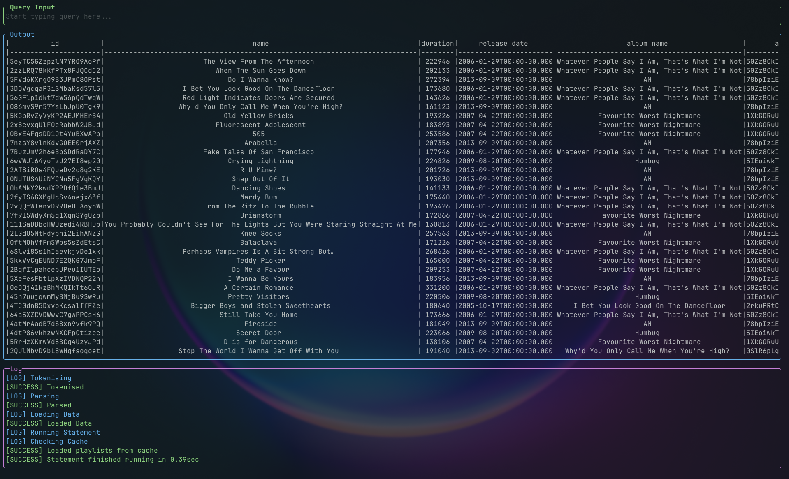

# spotifyQL
A SQL like query language for your spotify statistics

### Basic Query In The TUI


### Settings Dialog
WIP

## Examples
```SQL
SELECT COUNT(name) FROM PLAYLIST(pl1) WHERE "Arctic Monkeys" IN artists;
```
would could the number of arctic monkeys songs in the playlist pl1

```SQL
SELECT id, name FROM ALBUM(Whatever people say ...) WHERE popularity > 50 && release_date < 2014-01-01;
```

```SQL
SELECT COUNT(name) FROM PLAYLISTS;
```

## Features
 - Holding control when scrolling on a scrollable region will disable debouncing and allow you to scroll much faster at the cost of accuracy

## Attributes
the data available is the following

### Track Data
 - id: String
 - name: String
 - duration: Int
 - album_name: String
 - album_id: String
 - artists: List of String
 - added_at: String
 - popularity: Int

Track data is used when the data source is a specific playlist or saved album e.g. `PLAYLIST(pl1)`

### Playlist Data
 - id: String
 - name: String
 - tracks_api: String
 - track_count: Int

Playlist data is used when the data source is just `PLAYLISTS`

### Album Data
 - id: String
 - name: String
 - track_count: u64
 - popularity: u8
 - album_type: String
 - release_date: String
 - artists: List of String
 - saved_at: String

Album data is used when the data source is just `ALBUMS`
## Implementation
### Process
1. tokenise input
2. parse tokens into a struct
3. fetch necessary data
4. run parsed struct on fetched data
5. format and output

fetched data is cached in-memory so if the program is restarted all data needs to be refreshed, in-memory cached data has a TTL of 30 minutes.

### Dates
Dates must be delimited by either `-` or `/` and must in the `dd/mm/yyyy` or `dd/mm/yy` layout.

You can also provide just the year (`yyyy`) or just the month and year (`mm/yyyy` or `mm/yy`)

If using `dd/mm/yy` then 20yy will be used, unless that is in the future in which case 19yy will be used